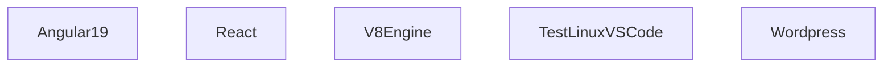

## 1. Stack
- Containerization: Docker, Docker Compose (docker-compose.yml per example)
- Angular 19 example: Angular 19, Node 18 (build stage), Nginx Alpine (serve stage) — multi-stage `Dockerfile`
- React example: React (Create React App), Node 20 — single-stage `Dockerfile`
- V8 Engine / Test Linux examples: Ubuntu (latest) base image, OpenSSH server, build-essential, Python 3
- No root-level package manifest — this repo is a collection of independent, self-contained Docker examples (per README.md)

## 2. Directory map
| path | what lives there |
|---|---|
| Angular 19/angular-docker-app | Dockerized Angular 19 app (multi-stage Node 18 build -> Nginx serve) |
| Angular 19/angular-docker-app/src | Angular application source |
| React/myapp | Dockerized React (CRA) app, Node 20 |
| React/myapp/src | React application source |
| React/myapp/public | React static/public assets |
| V8 Engine | Ubuntu container for V8 engine dev; SSH access on port 2222 |
| Test Linux OS Connect With VS code | Ubuntu container, general remote-dev environment; SSH access on port 2223 |
| Wordpress | docker-compose config for a Wordpress container (no README coverage) |

## 3. Diagram

Each node is an independent, self-contained Docker example — no cross-component dependencies observed (README.md describes each as a standalone "cd into folder and build" example).

## 4. Component index
- [[Angular19]]
- [[React]]
- [[V8Engine]]
- [[TestLinuxVSCode]]
- [[Wordpress]]

## 5. Entry points
- Angular 19 (dev/prod, multi-stage build+serve): `cd "Angular 19/angular-docker-app" && docker-compose up --build`
- React (dev): `cd React/myapp && docker build -t react-app . && docker run -p 3000:3000 react-app`
- V8 Engine (SSH dev container): `cd "V8 Engine" && docker-compose up --build`, then `ssh vscode@localhost -p 2222`
- Test Linux OS Connect With VS Code (SSH dev container): `cd "Test Linux OS Connect With VS code" && docker-compose up --build`
- Wordpress: `Wordpress/docker-compose.yml` present; no documented run command (TODO: verify)

## 6. Conventions
- Each example lives in its own top-level folder named after the technology/stack (e.g. "Angular 19", "React", "V8 Engine")
- Each example is self-contained: its own `Dockerfile`, and `docker-compose.yml` where orchestration is used
- Folder names containing spaces are used at the top level ("Angular 19", "Test Linux OS Connect With VS code") — shell commands must quote these paths
- Root README.md documents each example under a numbered "## Examples" section with Build/Run (and Base image/Includes/SSH Port where relevant) bullet list

## 7. Where things go
- Add a new Docker example: create a new top-level folder named after the stack, add a `Dockerfile` (and `docker-compose.yml` if orchestration is needed) inside it
- Document a new example: add a numbered subsection under "## Examples" in root README.md following the existing Build/Run bullet format
- Change how the Angular example builds/serves: edit `Angular 19/angular-docker-app/Dockerfile` and/or `docker-compose.yml`
- Change how the React example builds: edit `React/myapp/Dockerfile`
- Add orchestration to an example that lacks it (e.g. Wordpress): add/edit its `docker-compose.yml` and document the run command in root README.md
